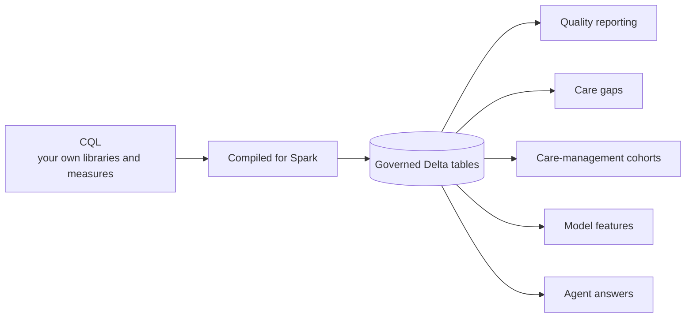

# Overview

Clinical Quality Language (CQL) is how healthcare writes clinical logic so a computer can run it. CMS publishes its quality measures in it, and the same definitions can drive care management, analytics and AI agents. Today they mostly stop at the quality report, because running CQL needs a separate engine, an export of the data, or a hand port to another language that drifts from the spec.

CQL on Databricks makes that clinical knowledge compute where your data already lives. It compiles published CQL to run natively on Spark, over your whole population, in your own workspace, under your Unity Catalog governance. The results are ordinary governed
tables. So the definition that reports a measure to CMS can also find a care gap, define a cohort, feed a model, or ground an agent's answer.

We want CQL to become the common language of clinical agents and analytical systems, connecting regulatory
reporting and care management. And we want running it to be cheap enough that teams spend their time on
what CQL can do, not on how to run it.

## Significance

**Translation Drift:** You run the published CQL itself. Nobody hand-ports it to another language, so there is no copy that drifts from the spec, and the clinician who wrote the intent can still read what runs.

**Clinical Semantic Layer:** A guideline or measure spec written in prose gets read a little
differently by every team that implements it. CQL fixes that meaning in a formal language, and it compiles
and runs the same way every time. Agents and models are probabilistic; the clinical definitions they act on
shouldn't be. An agent's answer, a model's feature and a quality report all rest on the same logic, and a
clinician can check it.

**Unified Stack:** Your analytics stack becomes your measurement stack. Results are Delta tables, so dashboards, alerts, pipelines and Genie work on them directly. A measure stops being a quarterly report and becomes a metric
anyone can ask about.

**Governance:** The compute runs in your workspace as the signed-in user: no extract, no
copy, nothing leaving your perimeter. Measures and results are Unity Catalog assets, so tags, lineage, row
filters and column masks apply to them like any other table.

## Example applications

FHIR standardized how clinical data is shared. CQL on Databricks standardizes how clinical knowledge is
shared, on a platform most organizations already operate. It follows HL7's own architecture (narrative
guideline, structured knowledge, executable logic), so a clinical definition belongs to a clinical
ontology, not to whichever tool consumes it. Define an example clinical condition once, and the measure, the
model and the care team all mean the same thing by it.

A few of the things teams can build on the results:



| Example use | Status |
|---|---|
| Calculate measure populations over everyone, and keep the results as tables | Available |
| Dashboards, alerts and pipelines on the results | Available. Results are ordinary Delta tables |
| Ask questions about results from Genie or any MCP client | Available. Read-only MCP tools ([agent](agent/README.md)) |
| Read a measure as a document, run it, and trace a count down to one patient | Available ([Designer](designer/README.md)) |
| Find each patient's open care gap, with the evidence, from the measure's own definitions | Planned (`AGENT-CARE-GAPS`) |
| Care-management cohorts, model features, payment-integrity rules | Build on the result tables. Not separate features |

This project does not replace your existing quality measure vendor. Its goal is getting CQL running on Databricks. What gets built on top of it is up to you and the community.

## Measure verification

The repository ships four sample measures written for it, with synthetic patients, in
[`examples/measures`](examples/README.md). They follow the shape CMS uses for FHIR quality measures (QI-Core
6.0.0, proportion scoring, exclusions, exceptions and supplemental data), with value sets of our own. They are
samples, not published measures.

| Measure | Library | What it computes |
|---|---|---|
| Hypertension control | `HypertensionBPControl` | Adults 18–85 with hypertension whose most recent blood pressure is below 140/90 |
| Diabetes, high or missing HbA1c | `DiabetesHighOrMissingA1c` | Adults 18–75 with diabetes whose most recent HbA1c is above 9% or missing (lower is better) |
| Adult flu immunization | `AdultFluImmunization` | Adults seen in the flu season who were vaccinated in it, with declined or contraindicated vaccines as exceptions |
| Colorectal screening | `ColorectalScreening` | Adults 45–75 current on colorectal cancer screening, each test with its own lookback |

They share `SampleMeasureCommon` and `SampleSupplementalData`, and run over the 48 sample patients in
`examples/data`, whose expected results are in `examples/data/expected-results`. Each patient's expected
result is checked against the Java CQF reference engine and the compiler
([testing-and-conformance.md](compiler/docs/testing-and-conformance.md)), and the release test checks them on a
deployed workspace (`CLIENT-RELEASE-TESTS`).

During development we also ran four published CMS eCQMs through the engine, in their FHIR versions: CMS124,
CMS68, CMS69 and CMS165. Each computed successfully, and its results were verified against the cqframework
reference engine on the measure's published test patients. The same measures were run over synthetic
populations of more than a million patients and completed in minutes.

## Components

| Component | Purpose |
|---|---|
| [Python client](compiler/client/README.md) (`cql-databricks`) | Run CQL from a notebook or Job and get a DataFrame back |
| [Durable calculations](compiler/client/docs/calculation-architecture.md) | Compute the defines you ask for, and what they depend on, into Delta tables you own, with reuse |
| [Compiler service](compiler/README.md) | Compiles CQL to run on Spark. Stateless; stores nothing |
| [Designer](designer/README.md) | An App to read, run and review a measure |
| [Agent](agent/README.md) | MCP tools and skills over the results |
| [Loader](loader/README.md) | Imports FHIR content, and generates synthetic patients |

## Get started

In a Databricks notebook, after deploying the bundle ([deploy guide](docs/deploy.md)), which publishes the
client wheel to a Volume:

```python
%pip install /Volumes/<catalog>/runtime/artifacts/wheels/cql_databricks-*.whl
from cql_databricks.compiler import cql
cql('define "Two": 2 + 2').exec("Two").display()
```

Or use the `%%cql` cell magic, where the cell itself is the CQL. Load it once:

```python
%load_ext cql_databricks.compiler
```

Then, in its own cell:

```
%%cql --df ages
define "BirthYears": { 1990, 2010, 1975 }
```

The magic shows the result. `--df ages` also binds it as a DataFrame, and each define is a temp view that
`%sql` can query (`SELECT * FROM BirthYears`).

To run a measure from a folder of `.cql` files:

```python
from cql_databricks.compiler import connect
client = connect(spark, library_path="/Workspace/Users/me/cql")
client.cql(library="<YourMeasure>") \
      .with_measurement_period("2026-01-01", "2026-12-31") \
      .exec("Numerator")
```

The [client guide](compiler/client/README.md) covers data sources, value sets, durable results and discovery
scopes. The notebooks in [`examples/`](examples/) walk through the same steps.

To build and test locally, with no workspace:

```bash
scripts/setup.sh        # Python venv and npm packages
scripts/test.sh         # fast offline tests
./gradlew checkAll      # JVM build, tests and the conformance suite
```

The conformance suite runs the compiled measures on a local Spark server that the build starts itself.

## How it works

A CQL engine usually evaluates one patient at a time. This compiler translates CQL, through ELM and a typed
intermediate form, into a Spark job that evaluates every patient at once. You get DataFrames back, and you can
trace any result to the CQL define that produced it.

It runs on your warehouse or cluster, as you, under your Unity Catalog grants, and results go where you put
them. The only shared service is the compiler, which is stateless and stores nothing.

The compiler and its runtime functions take no Databricks dependency. That keeps them testable on a local
Spark server, and the build checks it (`./gradlew checkNeutrality`).

## Where it's headed

| When | What |
|---|---|
| Now | Release v0.3. It includes a live release test that runs a measure from the built wheels and compares it with its answer key (`CLIENT-RELEASE-TESTS`) |
| Next | A synthetic demo population as a free Marketplace listing (`DATA-SYNTH-MARKETPLACE`). Care-gap agents: CQL probes derived from a measure's own logic explain each failure, computed in bulk, as the caller (`AGENT-CARE-GAPS`) |
| Through 2026 | The remaining upstream operator tests, and a published CQL support table |
| Later | Scale acceptance for durable calculations (`CLIENT-DURABLE-VALIDATE`). Natural-language authoring in the Designer (`APP-CREATE-NL`) |


## Repository layout

Each feature has a `README.md` in its folder.

| Feature | Code | What it is |
|---|---|---|
| [Compiler](compiler/README.md) | `compiler/{core,service,server,runtime}` | CQL to Spark, the compile service and its App, the runtime functions |
| [Client](compiler/client/README.md) | `compiler/client` | The `cql-databricks` Python package. Includes Data Bindings and durable calculations |
| Conformance | `compiler/conformance`, `compiler/cqf` | Measure corpus, test patients, expected results, the reference engine |
| [Designer](designer/README.md) | `designer/`, `designer/server/` | An App to read, edit and run measures |
| [Agent](agent/README.md) | `agent/` | MCP tools and skills |
| [Loader](loader/README.md) | `loader/{importer,synthesizer,scripts}` | FHIR content import, synthetic patients, the data sources this repository ships |
| [Common](common/README.md) | `common/` | The shared server library |
| [Deploy](docs/deploy.md) | `databricks.yml`, `scripts/deploy/`, `scripts/jobs/` | The Asset Bundle, its deploy scripts and Job entry points |

Cross-feature docs start at [docs/README.md](docs/README.md).

## Third-party libraries

Direct dependencies, with the licenses their packages declare. Test-only and build-only libraries are
marked. Lockfiles and `gradle/verification-metadata.xml` pin the exact versions.

<details>
<summary>Libraries and licenses</summary>

| Library | Used by | License |
|---|---|---|
| Apache Spark Connect client (`spark-connect-client-jvm`), Scala library and compiler | Compiler, runtime functions | Apache-2.0 |
| cqframework CQL translator and engine (`cql-to-elm-jvm`, `engine-jvm`, `engine-fhir`, `quick`, `ucum`) | Compiler, reference engine | Apache-2.0 |
| HAPI FHIR (`hapi-fhir-base`, `org.hl7.fhir.r4`) | Reference engine (conformance) | Apache-2.0 |
| ICU4J (`icu4j`), pulled in by Spark | Compiler App | Unicode-3.0 |
| uJson | Compiler, conformance | MIT |
| Apache Commons Codec | Reference engine | Apache-2.0 |
| SLF4J | Compiler, reference engine | MIT |
| ScalaTest (test only) | JVM tests | Apache-2.0 |
| JUnit 4 (test only) | JVM tests | EPL-1.0 |
| Databricks SDK for Python (`databricks-sdk`) | Client, common, agent, Designer | Apache-2.0 |
| Databricks Connect (`databricks-connect`, optional) | Importer | Databricks License |
| PySpark (`pyspark`, optional) | Client, importer | Apache-2.0 |
| Requests | Client, common, importer, Designer | Apache-2.0 |
| FastAPI, Starlette, Uvicorn | Designer server | MIT, BSD-3-Clause, BSD-3-Clause |
| python-dotenv | Designer server | BSD-3-Clause |
| OpenAI Python library (`openai`) | Designer server | Apache-2.0 |
| FastMCP | Agent | Apache-2.0 |
| HTTPX (test only) | Common | BSD-3-Clause |
| pytest, PyYAML, pyflakes, xmlschema (test only) | Python tests | MIT |
| React, React DOM, React Router | Designer | MIT |
| Monaco Editor, `@monaco-editor/react` | Designer | MIT |
| Lucide React | Designer | ISC |
| Vite, Vitest, jsdom, Testing Library, marked (build and test only) | Designer | MIT |
| TypeScript (build only) | Designer | Apache-2.0 |

Downloaded when an App starts or a page loads, not stored in this repository:

| Component | Used by | License |
|---|---|---|
| Eclipse Temurin JRE 21 | Compiler App (`compiler/server/deploy/bootstrap.py`) | GPL-2.0 with Classpath Exception |
| DM Sans and DM Mono fonts, from Google Fonts | Designer page | OFL-1.1 |

</details>

## Contributing

We don't accept external contributions. Open a GitHub issue for bugs or questions. Every fixture is
synthetic, so never attach real patient data to an issue. Report security issues to
bugbounty@databricks.com, without real patient data, PHI or credentials.

## License

[LICENSE](LICENSE.md). Third-party components and terminology notices, including the AMA CPT notice,
are in [NOTICE](NOTICE.md).
