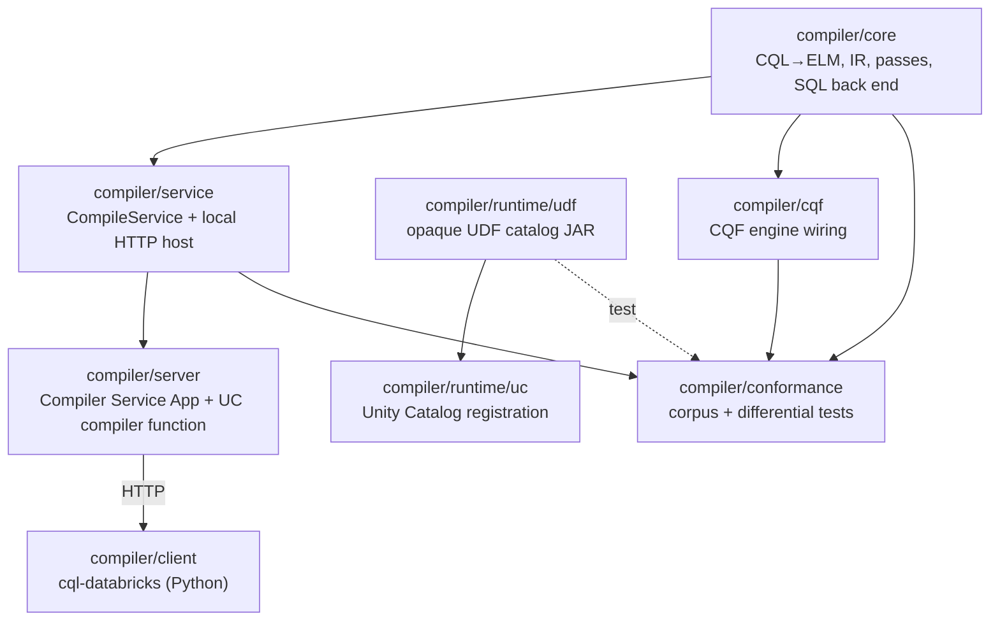

# Components

The compiler system's components (`BUILD-TAXONOMY`, `BUILD-MODULES`). A *module* is a file.

The compiler is pure lowering: CQL in, a Spark SQL script and metadata out, with no execution. Everything
that touches Spark is in the runtime, the test components and the Python client. `ARCH-PURITY` is
enforced by the build: `./gradlew checkNeutrality` fails if a Databricks or platform artifact resolves
into `compiler/core` or `compiler/runtime/udf`.

## `compiler/core`

The CQL to ELM front end (`translate`, on cqframework `cql-to-elm`, in-process, `TECH-ELM-INPUT`), the IR
(`ir`), the passes (`passes`), CQL semantics (`sema`: `Bool3`, intervals, UCUM, the static `FhirModel` and
`FhirSchema`), and the SQL back end (`transpiler`). Output is SQL text and the `LibraryGraph` metadata. No
`SparkSession`. Spark is `compileOnly`, for the retrieve-adapter traits and Spark data types.

## `compiler/service`

`CompileService`, the compile operations (`/compile-sql`, `/compile-pipeline`, `/describe`), and
`OssCompileHostMain`, a JDK `HttpServer` host for local development and tests. No Spark.

## `compiler/server`

The Compiler Service App (`CompilerServiceApp`, `SVC-API-HOST`), with auth and a response cache, and
`UcCompiler`, the same protocol in a UC Scala UDF. Deploy files are in `compiler/server/deploy/`. See
[compiler-service.md](compiler-service.md).

## `compiler/runtime/udf`

The versioned opaque UDF catalog the emitted SQL calls by name (`EXEC-OPAQUE-UDF`,
[execution-model.md](execution-model.md)). Depends on nothing else in this repository, so no compiler
class can ride a UDF closure onto a cluster (`ARCH-PURITY`).

## `compiler/runtime/uc`

Registers the same functions as Unity Catalog Scala UDFs (`EXEC-UC-MANIFEST`). See its
[README](../runtime/uc/README.md).

## `compiler/cqf`

The CQF reference engine wired for in-memory evaluation (`CONF-GROUND-TRUTH`). Used by the conformance suite as
the oracle.

## `compiler/conformance`

The CQL corpus (`src/test/resources/cql`), the corpus translator (`translateCorpus`), test data, golden
snapshots and every differential and integration test. The SQL tests run the compiled script with
`spark.sql` against a Spark Connect server. See [testing-and-conformance.md](testing-and-conformance.md).

## `compiler/client`

The `cql-databricks` Python package. It reaches the compiler over HTTP and runs the compiled SQL with
`spark.sql`. See the [client README](../client/README.md).

## Dependencies

| Component | Language | Depends on |
|---|---|---|
| `compiler/core` | Scala | cqframework `cql-to-elm`, Spark `compileOnly` |
| `compiler/service` | Scala | `compiler/core` |
| `compiler/server` | Scala | `compiler/core`, `compiler/service` |
| `compiler/runtime/udf` | Scala | nothing in this repository (Spark `compileOnly`) |
| `compiler/runtime/uc` | Scala | `compiler/runtime/udf` |
| `compiler/cqf` | Scala | `compiler/core`, cqframework `engine-jvm` |
| `compiler/conformance` | Scala | `compiler/core`, `compiler/service`, `compiler/cqf`, `compiler/runtime/udf` (tests) |
| `compiler/client` | Python | the compile service, over HTTP |

The compiler ships no pipeline runtime. Callers run the `/compile-pipeline` plan in their own execution
model ([pipeline-runtime.md](pipeline-runtime.md)).
