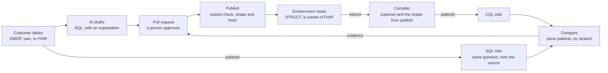

# Verified data mapping (proposed)

Status: proposed, not built. It plans two roadmap steps, `DATA-MODEL-SUBSET` and `DATA-MAPPING-VERIFY`, and
the open decisions `DEC-MODEL-SUPERSET-BOUND` and `DEC-MAPPING-HOME`, in the [roadmap](../roadmap.md). No
requirement is amended yet; each step lists the ones it would amend. The same design, with its figures, is
[verified-data-mapping.html](verified-data-mapping.html): open it in a browser.

The compiler knows all of the FHIR it supports. Each customer publishes the part their data fills, through
SQL that AI writes and a person approves. Paired checks prove the mapping: a CQL answer and a direct SQL
answer must name the same patients.

## Problem

Getting a customer's data into the model a library declares, with the right codes, is most of the work of
running a measure on it (`APP-FOCUS`). Sources vary: a proprietary canonical schema, OMOP, or FHIR. Two
things stand in the way today:

- **One fixed shape.** The compiler holds one shape per resource: FHIR R4 with loop cuts and bounded
  extensions (`DATA-MODEL-SCHEMA`, `DATA-MODEL-CUTS`). Data beyond the cuts is dropped on load, CQL that
  reads it does not compile, and widening the shape is a code change and a release.
- **No proof a mapping is right.** A mapping is a view or a pipeline someone wrote. Nothing shows that it
  answers questions the way the source data does, or which paths it leaves unmapped.

## What the design respects

| Constraint | Answer |
|---|---|
| Nobody hand-codes transforms: the user guides, AI drafts, a person reviews | AI writes plain SQL and explains it in plain language. Reviewers read the explanation and the check results |
| Transforms get messy: a legacy feed, a clinic's odd codes | SQL can be as messy as the data needs. The checks catch what a patch breaks |
| CQL declares its model: `using QICore '4.1.1'` fixes the meaning of every path | The compiler always runs against that model. Views fill a subset of it. No third model sits in between |

## The two changes

| `DATA-MODEL-SUBSET`: implementers own the shape | `DATA-MAPPING-VERIFY`: mappings are generated and proven |
|---|---|
| The compiler checks CQL against a superset: the FHIR R4 type graph for the supported resources, with no loop cuts | AI drafts SQL views or Lakeflow pipelines and explains them. A person approves, in a pull request |
| A published view returns any subset of it, never an extra field | Ground-truth checks pair a CQL expression with an independent SQL query over the source |
| Publish records the environment's shape. A compile gets it in its request, so it stays offline | A check passes when both return the same patients, not only the same count |
| A real FHIR path the shape leaves out fails the compile, naming the path. It never reads as null | Skills and tools for Genie Code and the agent, an App, and prebaked workflows |

They meet in one place: the published shape is the coverage map. "Is this path mapped here?" and "will this
CQL compile here?" are the same question, and every "not in this environment" error is the next mapping
task.

## Implementer-owned shapes (`DATA-MODEL-SUBSET`)

- **A superset in the compiler.** The compiler checks paths against the FHIR R4 type graph for the supported
  resources. The graph is finite where FHIR's types loop, so walking it needs no cuts. Physical depth is
  whatever the views return. `FhirShape` becomes the default shape the stock reshape writes.
- **A subset in each view.** A published view returns any subset of the superset: the same names and types at
  every level, lists as lists, never an extra field. Publish refuses a view that breaks this, and records the
  environment's shape with a hash.
- **Fail loud on a missing path.** A compile gets the environment's shape in its request
  (`TYPE-OFFLINE-COMPILE`). The implementer adds a missing path to the view, as nulls where they have no data.
- **Typed against the shape.** Lowering takes nested types from the shape: the retrieve function's
  `RETURNS TABLE`, union arms and choice handles (`ResourceStruct.structType`). A `Full` demand means
  everything the view publishes.
- **One demand analysis.** Pruning already works this way at the top level: `passes.RetrieveDemand` lists the
  fields a library navigates, and the SQL back end treats that list as the contract a narrow mount is built
  to (`EMIT-SQL-RETRIEVE-DEMAND-BOUND`). Demand goes from top-level fields to full paths
  (`passes.RetrieveDemand`, `passes.ChoiceDemand`), so one analysis gives pruning, the shape check and data
  requirements (`APP-DATA-REQS`). The roadmap's "Field demand off a nested element" gap is fixed first.
- **Identity.** The shape's hash is part of a result's identity and of the compiled-SQL cache key, so a
  changed view never reuses an old score (`CLIENT-RESOLVER-IDENTITY`).

How a path is checked:

| Path | In FHIR R4 | In the environment's shape | Result |
|---|---|---|---|
| `Observation.valueQuantity` | Yes | Yes | Compiles, typed against the shape |
| `Condition.code.coding.code` | Yes | Yes | Compiles |
| `Condition.clinicalStatus` | Yes | No | Fails the compile: not in this environment. Add it to the view, as nulls if there is no data |
| `Patient.extension.extension` | Yes | No | Fails the compile: not in this environment |
| `Observation.result` | No | n/a | Fails the compile: not a FHIR path |
| `legacy_flag`, a column a view publishes | No | n/a | Publish refuses the view |

Amends `DATA-MODEL-SCHEMA`, `DATA-MODEL-CUTS`, `DATA-PATH-IN-SCHEMA`, `DATA-SCHEMA-CONTRACT`,
`ARCH-RETRIEVE-PROJECT`, `BIND-RESHAPE`, `BIND-SCHEMA-CHECK`, `BIND-PUBLISH` and
`CLIENT-RESOLVER-IDENTITY`, and replaces the cut rules `DEC-RESOURCE-VARIANT` settled
([resource-schema.md](resource-schema.md)).

## Verified mapping (`DATA-MAPPING-VERIFY`)

### How a mapping is made and proven



The two sides of a check reach the patients by different routes. The CQL side goes through the mapping and
the compiler; the SQL side goes straight to the source. Agreement is evidence the mapping is right for that
question. Every check re-runs on each change and after each data refresh. Mappings live in a bundle in git.
Views are the default; a pipeline materializes a mapping that is too slow as a view, or that needs Python or
AI functions.

### A check pair, and a failure it catches

An example on synthetic figures: `active-diabetes-2026`.

CQL side, through the published views and the compiler:

```cql
define "Active Diabetes":
  exists ([Condition: "Diabetes"] C
    where C.clinicalStatus ~ "active"
      and (C.onset as dateTime) before end of "Period")
```

SQL side, written by the customer's analyst over OMOP:

```sql
SELECT DISTINCT co.person_id
FROM   omop.condition_occurrence co
JOIN   omop.concept c ON c.concept_id = co.condition_source_concept_id
JOIN   check_codes.diabetes v
       ON v.vocabulary = c.vocabulary_id AND v.code = c.concept_code
WHERE  co.condition_start_date < DATE'2027-01-01'
  AND  coalesce(co.condition_end_date, DATE'9999-12-31') >= DATE'2026-01-01'
```

| | |
|---|---|
| Ground truth | A person: the analyst who owns the diabetes registry report |
| Codes | Both sides use the same expansion of the Diabetes value set |
| Result | Fails. CQL 4,212 patients, SQL 4,230; 18 only in SQL, 0 only in CQL |
| Diagnosis | The 18 patients have a diabetes row that ended in January 2026. The view maps an end date to `abatement` with status `resolved`, so the CQL side drops them. The SQL side counts anyone active at any time in the year. The mapping is right and the check asks a different question. The analyst narrows the SQL to "active at the end of the period", and the check passes |

A failure can sit in the mapping, in the check or in the compiler. A compiler gap found this way gets a
minimal conformance test with its fix.

### Making the checks worth trusting

| Rule | Why |
|---|---|
| Compare patient sets, not counts | Two errors can cancel in a count. A set difference names the patients to look at |
| Record where the SQL came from | A person, an existing report, or an AI session that never saw the mapping. If one AI writes both sides from the same misunderstanding, they agree and are both wrong |
| Same codes on both sides | A check states its value-set expansion. Otherwise a mismatch is about terminology, not mapping |
| Synthetic patients and real data | Hand-made source records with known answers give exact tests on every change. Checks on real data run in the customer's workspace, as the caller |
| Show what no check covers | The compiler knows which paths a check's CQL reads, so the tools list paths that are mapped but unverified |

### Coverage and quality, per path

An example on synthetic figures:

| Path | In the shape | Checks | Filled | Codes in value sets |
|---|---|---|---:|---:|
| `Condition.code` | Yes | 3 pass | 100% | 96% |
| `Condition.clinicalStatus` | Yes | 1 pass | 98% | n/a |
| `Observation.code` | Yes | 2 pass | 100% | 94% |
| `Observation.valueQuantity` | Yes | None | 82% | n/a |
| `MedicationRequest.dosageInstruction` | No | None | n/a | n/a |

Is it good enough? Unmapped local codes are shown as their effect on a score. Run the measure once with them
counted in the value set and once with them out: the rate lies between the two, say 61% to 68%, and mapping
the top three local codes closes most of the gap.

### The tooling

| Piece | What it does |
|---|---|
| Genie Code skills | Map a path from where the user says it lives · write a check pair · diagnose a failed check down to source rows · explain a view in plain language |
| Tools | The paths a CQL expression reads · unverified and missing paths · run a check pair and diff the patient sets · publish views (`BIND-PUBLISH`) · create a pipeline |
| The mapping App | Paths by status (missing, mapped, verified, failing) · checks and their history · drill into a failure, patient by patient · approve and publish versions |
| Workflows | Onboard a source · add a measure · close a gap an ad-hoc question hit · re-run every check after a refresh, as a Lakeflow Job |
| Prebaked content | Stock checks for OMOP, whose SQL is generic · the same check templates for other schemas · code mappings as ConceptMaps (`DATA-CROSSWALK`, `BIND-CONCEPTMAP`) |
| Unstructured notes | `ai_extract` driven by data requirements · rows with provenance, in a separate source · always materialized, with scores shown with and without them |

Cites `APP-FOCUS`, `APP-MAPPING`, `APP-DATA-REQS`, `DATA-CROSSWALK`, `BIND-CONCEPTMAP`, `BIND-SELFDIFF` and
`BIND-PUBLISH`. Its coverage report needs `DATA-MODEL-SUBSET`.

## Considered and set aside

| Option | Why not |
|---|---|
| Keep one fixed shape with cuts | Data beyond a cut can't be read, and widening the shape takes a release |
| `VARIANT` for every resource | A view building `VARIANT` pruned nothing and ran 2.5 times slower. Typing a whole record at the mount crashed the warehouse. Wrong types surface while a measure runs |
| An internal canonical model | CQL declares QI-Core, so a second translation is needed, and its meaning can drift |
| A mapping language of our own | AI explains SQL more readably than a new language, and nobody wants to learn one |
| FHIR StructureMap as the runtime | It runs resource by resource in a mapping engine, with no pushdown into source tables. ConceptMap stays, for codes |
| Genie Code alone | It writes the SQL well, but without checks nothing proves it, and nothing stops a patch from breaking a measure. Here it is the drafting engine |

## Measured

On a SQL warehouse, 10M synthetic rows, 2026-11-02:

| Query | Time |
|---|---:|
| A view building STRUCT records from relational tables. It pruned an unused source column | 1.23 s |
| The same view building `VARIANT`. It pruned none | 3.14 s |
| The same query on a materialized STRUCT table | 0.39 s |
| A view that collects codings per row. Mappings like this should be pipelines | 4.44 s |

On the same warehouse, `variant_get(r, '$', '<record struct>')` over a shredded `VARIANT` table, filtered on
a field of the result, crashed an executor on every run (`TASK_FAILED_EXECUTOR_LOSS`, exit code 134).
Nothing else in this record is measured.

## Open before building

- `DEC-MODEL-SUPERSET-BOUND`: which part of FHIR R4 the superset holds: resource types, extension value types,
  extensions on elements and primitives, and `contained`.
- `DEC-MAPPING-HOME`: a lens in the Designer or its own App, and where mappings, checks and their run history
  are stored.
- Nested demand: the field-demand gap on nested elements is fixed first, then demand goes from fields to full
  paths.
