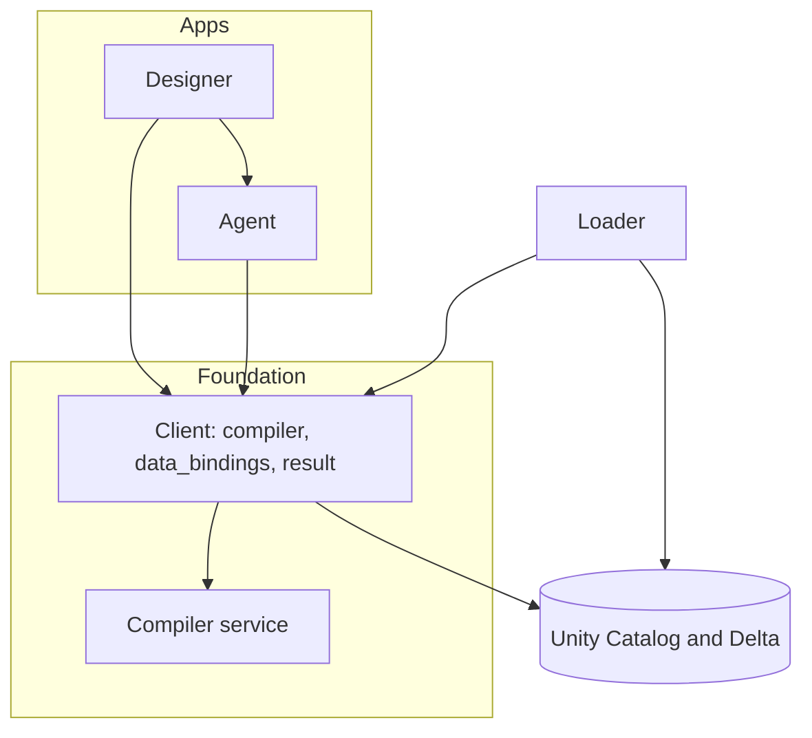

# Features and their boundaries

What each feature owns, what it doesn't, and how others reach it (`BUILD-SYSTEMS`). The levels and naming
rules are in [`structure.md`](structure.md).

Where a built-in Databricks object can carry a concern (a Unity Catalog tag, a grant, a Delta table), it
does. No feature builds its own store for it.

An arrow means "depends on".

## loader

`loader/importer`, `loader/synthesizer`, `loader/scripts`. Ships separately, as tools.

- **Owns:** the importer, which loads eCQM content and value sets into a schema you name and tags it, and
  the synthesizer, which writes synthetic patients to a schema you name. The data sources this repository
  ships (`SHIPPED-SOURCES-IN-LOADER`): the population lander every shipped source lands through, the change-log
  exemplar, and the script that lands a synthesized cohort (`loader/scripts/`). The deploy loads the sample
  measures and the `sample-patients` data source from `examples/` through `content_ingest.samples`.
- **Doesn't own:** finding or checking what it wrote (the client's `data_bindings`).
- **Interface:** the `cql-content-ingest` and `cql-synth` commands. You run the importer yourself; the
  deploy never runs it, because eCQM content and value sets are licensed (`SHARE-LICENSING`).

## compiler

`compiler/{core,service,server,runtime,client,conformance,cqf}`.

- **Owns:** CQL to ELM to typed IR to Spark SQL, and CQL semantics. The data-source binding contract: what a
  `retrieve_<Type>` function must look like, and the optional change log. The runtime `cql_*` functions,
  registered for open-source Spark (`udf`) or Unity Catalog (`uc`). The Python client (below). The conformance
  suite, and `cqf`, the reference engine conformance checks against.
- **Doesn't own:** state or scheduling. Results belong to the client, never the service. Any Databricks
  dependency in `core` or `runtime/udf`
  (`ARCH-PURITY`, checked by `./gradlew checkNeutrality`).
- **Interface:** `/translate`, `/compile-sql`, `/compile-pipeline` and `/describe` over HTTP, and the
  client.

## client

`compiler/client`, the `cql-databricks` wheel. Part of the compiler feature; it runs as the caller.

- **Owns:**
  - `cql_databricks.compiler`: `cql()`, compiling through the compiler service, and data sources as a caller
    sees them (`cql_databricks.compiler.data_source.list_data_sources`). Publishing a data source over your
    tables (`BIND-PUBLISH`): its schema, `retrieve_<Type>` functions and tag, never its data.
  - `cql_databricks.data_bindings`: the resolver, which finds schemas by UC tag, checks their tables and
    columns, and reads a library closure (`CONTENT-RESOLVER`); the knowledge and terminology layouts; the
    runtime knowledge views (`DATA-BINDINGS`); the data-source declaration.
  - `cql_databricks.result` (`RESULT-INTO-CLIENT`): durable bulk calculations (`materialize`). They run in your
    SQL session and write result tables you own (`RUN-CLIENT-DURABLE`). Reading results: the membership
    predicate and the explain, flow, strata and metrics derivations (`cql_databricks.result.insights`). The
    expiry of private results that the maintenance Job runs (`RUN-CLIENT-MAINTENANCE`).
- **Doesn't own:** writing FHIR data, content or value sets (loader), value-set expansion (done upstream),
  rendering (designer), the Jobs and principals the deploy creates (`DEPLOY-OWNS-PRINCIPALS`), publishing
  shared results (the implementer's, `RUN-CLIENT-PUBLISHED`). It has no Lakebase state.
- **Interface:** the `cql_databricks.compiler`, `cql_databricks.data_bindings` and `cql_databricks.result`
  packages. A result's UC tags are the contract another client discovers and reuses it by.

## agent

`agent/`.

- **Owns:** the tool library over the client's results and data bindings, a tool registry, and the MCP App.
- **Doesn't own:** the Specification tools. The Designer registers those.
- **Interface:** MCP.

## designer

`designer/`, `designer/server/`.

- **Owns:** the Specification document (narrative, provenance, lenses, outline), the authoring
  experience, the run log and its assistant.
- **Doesn't own:** running measures or deriving results. It calls the client, as the signed-in user, like
  any other caller (`SEC-OBO`).
- **Interface:** an App.

## Apps

| App | Feature |
|---|---|
| `cql-databricks-compiler` | compiler |
| `cql-databricks-designer` | designer |
| `mcp-cql-databricks` | agent |

The Apps find each other by name (`SVC-APP-TOPOLOGY`). None of them uses Lakebase.

## Client verbs

| Verb | Runs where | Who owns the work |
|---|---|---|
| `compile(...)` | the compiler service | nobody; it returns SQL |
| `run(...)` | your session or warehouse | you: retries, tables, cleanup |
| `materialize(...)` | your SQL warehouse, through the client (`cql_databricks.result`) | you; the client manages the tables |

The client's mode is fixed when you construct it. It never switches per call (`BUILD-CLIENT-SCOPES`).

## Dependency rules

1. No two-way dependencies between features.
2. HTTP counts as a dependency.
3. Each feature exposes one public package. Other features import only that.
4. One owner per definition: the membership predicate, the results address and the fingerprint each have
   one implementation.
5. A feature reads another's data through its interface, never by querying its tables.
6. Contracts customers implement, the `retrieve_<Type>` signature and the change log, are versioned on
   purpose (`DATA-CONTRACT`).

Known crossings: the agent reads result tables directly and has its own copy of the tag lookup
(`agent/wiring.py`). The Designer and agent servers import `cql_databricks_common`. A dependency check
(`CHECK-FEATURE-DEPS`) is not built yet.
